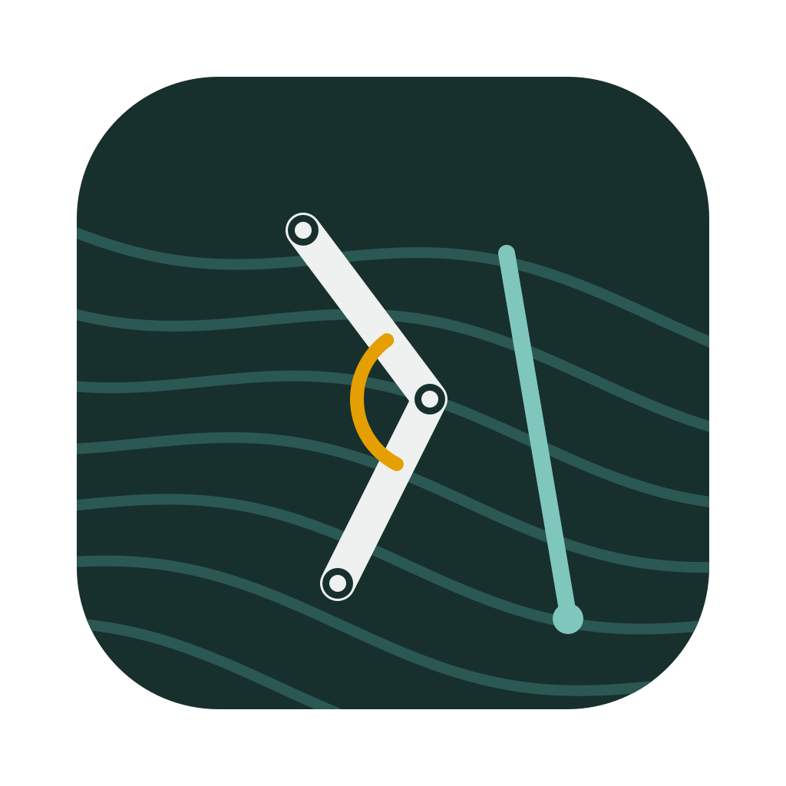

# TrailBuddy Analyzer

A desktop app for our biomechanics class project. It measures how **trekking poles change knee loading during
stair or downhill descent**, and whether that shifts load to the **arms and shoulders**.

Import your front and side phone videos. The app pairs and syncs them with the clap, then tracks the body and the poles in both views. It then computes
joint angles and estimates knee extensor moment, quadriceps force and arm moments. Every number is labelled as
*measured*, *video estimate*, *model estimate*, *scenario (assumed force)* or *unavailable*, so you always know how
much to trust it.

> **Status (v1).** Every calculation, the clap sync and all app controls are tested on synthetic data with known
> answers, and the tests run automatically on macOS, Windows and Linux. Pose and pole tracking on **real
> recordings of our participants is awaiting validation**. See [Features and limitations](docs/features-and-limitations.md).

---

## 1. Install (one time)

You need about 2 GB of free disk space and internet for the first install.

**Get the code.** On GitHub, click **Code → Download ZIP** and unzip it somewhere permanent, such as
`Documents/TrailBuddy`. If you use git, run `git clone https://github.com/Berkonas/knee.git` instead.

### macOS (Apple-silicon Macs: M1 or newer)

1. Open the folder in Finder, then open `scripts`.
2. Double-click **`install_mac.command`**. If macOS says it can't be opened, right-click it, choose **Open**,
   then click **Open** again. This happens only once.
3. Wait a few minutes. The script asks before installing *uv*, the Python installer it uses.
4. **TrailBuddy Analyzer** now appears on your Desktop (the app itself lives inside this folder). Double-click it to start.
   You don't need a terminal after this.

### Windows 10/11

1. Open the folder, then open `scripts`.
2. Double-click **`install_windows.bat`**. If Windows SmartScreen appears, click **More info → Run anyway**.
3. Wait a few minutes. A **TrailBuddy Analyzer** shortcut appears on your Desktop.

**Standalone builds.** You can also download a ready-made app with no install step from the
[GitHub Actions "Build apps" workflow](../../actions/workflows/build.yml) (open the latest run, then the
**Artifacts** section). These builds are unsigned, so see [Troubleshooting](docs/troubleshooting.md) for the
one-time security prompt.

## 2. Use it

1. **File → New study…** Choose an empty folder. Your results are stored there and never uploaded.
2. **Import recordings…** (button at the bottom of the experiment browser) and choose the folder with your phone
   videos. The app then:
   * reads each file's metadata: resolution, frame rate, duration, device and HDR
   * detects which recordings are **front** and **side** views from the person's posture
   * groups recordings by **participant** using clothing colour
   * **pairs** front and side recordings of the same trial by matching their sound

   Check the review table, fix anything wrong, then click **Create trials**. File names don't matter.
3. Enter each participant's **body metrics**: right-click the participant, then **Body metrics…**. Mass and height are
   needed for every force or moment.
4. Click a trial in the browser. The front and side videos play **in sync** from one clock. Use Space, ← and →
   (Shift for 10 frames), and the speed menu (0.1×–2×).
5. **Sync** tab: **Audio clap** aligns the views automatically. Check that both views show the hands meeting.
   **Visual clap** works without audio, and the ±1 frame buttons give frame-exact manual control.
6. **Trial** tab: set the condition (no poles, standard, −5 cm, +5 cm…), the trial number and the analysis interval. Press
   I and O at the cursor to set the start and end.
7. **Analyse trial**, or **Analyse all trials**. The app tracks the body (RTMPose) and both poles in both views.
   Tracking is cached, so changing biomechanics settings later is instant.
8. Inspect the results:
   * The overlays show the skeleton, the poles, the joint trajectories and live knee angles.
   * The plots under the video are linked to it: click a plot to jump the video, or play the video to move the plot cursor.
   * The **Measures** tab lists the values at the cursor and the trial summary, with evidence labels and the camera view.
9. **Export trial…** writes the time-series CSV, the summary, events, figures, an annotated video and the processing
   settings into `<folder>/<participant>/<trial>/`.
10. **Compare** (top of the window) compares conditions within each participant across every metric. **Export all
    results…** writes the study-level tables, an Excel workbook and figures.

**Create demo study** (on the Study page) builds a study from synthetic data, so you can try Compare without
recordings.

## 3. What the app measures

| Quantity | How | Evidence label |
|---|---|---|
| Knee, hip, ankle, trunk, shoulder, elbow angles; angular velocity; segment orientation | RTMPose landmarks (side view), filtered, 2D | Video estimate |
| Knee frontal-plane projection angle, trunk sway, pelvic tilt, step width, pole spread | RTMPose landmarks (front view), 2D, scale-free | Video estimate |
| Step time, stance time, cadence, speed | Foot speed (velocity threshold); scale | Video estimate |
| Pole tip, axis angle, contact timing, plant timing vs foot strike | Automatic hand-anchored pole detection (or manual clicks) | Video estimate (checked visually, not yet validated against markers) |
| Knee extensor moment | Inverse dynamics with force-plate data, **or** a quasi-static model with an assumed foot force | Model or Scenario |
| Quadriceps force | Knee moment ÷ patellar tendon moment arm (5 cm; 4–6 cm range) | Model or Scenario |
| Knee negative work, cumulative knee angular impulse | Mechanical-demand metrics (not fatigue) | Model or Scenario |
| Elbow and shoulder moments | Pole force along the pole axis at the hand | Model or Scenario |
| Tibiofemoral compression, pole force from video alone | Not estimated; the app says what extra data is needed | Unavailable |

All equations, assumptions and references are in **[docs/methods.md](docs/methods.md)**.

## 4. Documentation

* [User guide and experiment workflow](docs/user-guide.md): test-day checklist and the step-by-step analysis workflow
* [Scientific methods](docs/methods.md): every equation, assumption, unit and source
* [Features and limitations](docs/features-and-limitations.md): what is implemented, tested, or awaiting validation
* [Troubleshooting](docs/troubleshooting.md)
* [Data formats](docs/data-formats.md): output files and how to import force data
* [Research pipeline](RESEARCH_PIPELINE.md): short methods description for the report
* [Developer guide](DEVELOPER.md): setup, architecture, packaging, troubleshooting
* [Literature](docs/research/literature.md) and [open-source tool survey](docs/research/open-source-tools.md)
* [Project brief summary](docs/project/assignment-summary.md) and our experimental protocol (`docs/project/`)
* `docs/TrailBuddy_Methods_Summary.docx`: a short, readable Word summary of the math, logic and references

## 5. Privacy

Participant videos and results are stored only in the study folder you choose. They are never uploaded, and
`.gitignore` keeps videos and study folders out of the repository. Use participant codes, never names.

## 6. Credits and licences

The app's code is MIT-licensed. It builds on RTMPose and YOLOX via rtmlib (Apache-2.0; models from OpenMMLab,
Apache-2.0), ONNX Runtime (MIT), MediaPipe (Apache-2.0), pyqtgraph (MIT), OpenCV (Apache-2.0), PySide6/Qt (LGPL-3.0),
NumPy, SciPy, pandas and matplotlib (BSD-style), openpyxl (MIT) and imageio-ffmpeg (BSD; it bundles an FFmpeg binary).
Biomechanics references are listed in [docs/methods.md](docs/methods.md). This is a class project, and the
TrailBuddy scenario is fictional.
