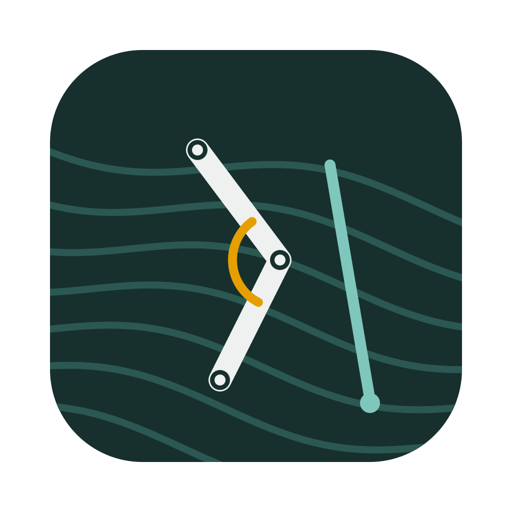

# TrailBuddy Analyzer

A desktop app for our biomechanics class project. It measures how **trekking poles change knee loading during
stair or downhill descent**, and whether that shifts load to the **arms and shoulders**.

Load a phone video (or two), sync them with a clap, and the app tracks the body and the poles. It then computes
joint angles and estimates knee extensor moment, quadriceps force and arm moments. Every number is labelled as
*measured*, *video estimate*, *model estimate*, *scenario (assumed force)* or *unavailable*, so you always know how
much to trust it.

> **Status (v1).** Every calculation, the clap sync and all app controls are tested on synthetic data with known
> answers, and the tests run automatically on macOS, Windows and Linux. Pose and pole tracking on **real
> recordings of our participants is awaiting validation**. See [Features and limitations](docs/features-and-limitations.md).

---

## 1. Install (one time)

You need about 2 GB of free disk space and internet for the first install.

**Get the code.** On GitHub, click **Code → Download ZIP** and unzip it somewhere permanent, such as
`Documents/TrailBuddy`. If you use git, run `git clone https://github.com/Berkonas/knee.git` instead.

### macOS (Apple-silicon Macs: M1 or newer)

1. Open the folder in Finder, then open `scripts`.
2. Double-click **`install_mac.command`**. If macOS says it can't be opened, right-click it, choose **Open**,
   then click **Open** again. This happens only once.
3. Wait a few minutes. The script asks before installing *uv*, the Python installer it uses.
4. **TrailBuddy Analyzer** now appears on your Desktop (the app itself lives inside this folder). Double-click it to start.
   You don't need a terminal after this.

### Windows 10/11

1. Open the folder, then open `scripts`.
2. Double-click **`install_windows.bat`**. If Windows SmartScreen appears, click **More info → Run anyway**.
3. Wait a few minutes. A **TrailBuddy Analyzer** shortcut appears on your Desktop.

**Standalone builds.** You can also download a ready-made app with no install step from the
[GitHub Actions "Build apps" workflow](../../actions/workflows/build.yml) (open the latest run, then the
**Artifacts** section). These builds are unsigned, so see [Troubleshooting](docs/troubleshooting.md) for the
one-time security prompt.

## 2. Use it in 10 steps

1. **Study → New study…** Choose an empty folder and an experiment template (Experiment 1, 2 or 3; you can edit it later).
2. **Add participant.** Use codes like P01, never names. Enter **body mass and height**. Measured segment lengths
   (thigh, shank, …) are optional and make the scale more accurate.
3. **Add one-camera trials…** Select your videos. Files named like `P01_C1_T01.mp4` fill in the participant,
   condition and trial number automatically. For two views, use **Add two-camera trial…**
4. **Open for analysis.** Play or step through the video and click **Set start** and **Set end** around the descent.
5. **Scale.** For best accuracy, choose *Measured distance*, click **Pick 2 points** on something you measured
   (such as a stair riser) and type its length. Otherwise the app uses the participant's height.
6. **Two cameras only:** click **Detect clap from audio**. If that fails, mark the clap frame in each video and click
   **Apply manual sync**. Check that both views show the same moment, then click **Use common window**.
7. **Poles (optional).** Put bright tape on each pole tip. Click **Pick marker colour**, click the tape, then **Track marker**.
   You can also click **Click to annotate** and mark the tip by hand.
8. **External forces.** Pole force can't be seen on video. Choose a **scenario** (e.g. 10% body weight per
   planted pole), or import measured force data.
9. **Run analysis.** The Summary tab lists every metric with its evidence label. The plot tabs show joint angles,
   knee load, contact events and the sensitivity analysis.
10. **Results** compares conditions within each participant. **Export all results…** writes CSV files, an Excel
    workbook, PNG, SVG and PDF figures, and a plain-language summary.

The **Create demo study** button builds a study from synthetic data so you can try the Results page right away.
These are not real results.

## 3. What the app measures

| Quantity | How | Evidence label |
|---|---|---|
| Knee, hip, ankle, trunk, shoulder, elbow angles | MediaPipe pose landmarks, filtered, 2D | Video estimate |
| Step time, stance time, cadence, speed | Foot speed (velocity threshold); scale | Video estimate |
| Pole tip position, angle, contact timing | Colour marker or manual clicks | Video estimate (awaiting validation) |
| Knee extensor moment | Inverse dynamics with force-plate data, **or** a quasi-static model with an assumed foot force | Model or Scenario |
| Quadriceps force | Knee moment ÷ patellar tendon moment arm (5 cm; 4–6 cm range) | Model or Scenario |
| Knee negative work, cumulative knee angular impulse | Mechanical-demand metrics (not fatigue) | Model or Scenario |
| Elbow and shoulder moments | Pole force along the pole axis at the hand | Model or Scenario |
| Tibiofemoral compression, pole force from video alone | Not estimated; the app says what extra data is needed | Unavailable |

All equations, assumptions and references are in **[docs/methods.md](docs/methods.md)**.

## 4. Documentation

* [User guide and experiment workflow](docs/user-guide.md): test-day checklist and the step-by-step analysis workflow
* [Scientific methods](docs/methods.md): every equation, assumption, unit and source
* [Features and limitations](docs/features-and-limitations.md): what is implemented, tested, or awaiting validation
* [Troubleshooting](docs/troubleshooting.md)
* [Data formats](docs/data-formats.md): output files and how to import force data
* [Developer guide](docs/development.md): setup, tests, building, project structure
* [Literature](docs/research/literature.md) and [open-source tool survey](docs/research/open-source-tools.md)
* [Project brief summary](docs/project/assignment-summary.md) and our experimental protocol (`docs/project/`)
* `docs/TrailBuddy_Methods_Summary.docx`: a short, readable Word summary of the math, logic and references

## 5. Privacy

Participant videos and results are stored only in the study folder you choose. They are never uploaded, and
`.gitignore` keeps videos and study folders out of the repository. Use participant codes, never names.

## 6. Credits and licences

The app's code is MIT-licensed. It builds on MediaPipe (Apache-2.0), OpenCV (Apache-2.0), PySide6/Qt (LGPL-3.0),
NumPy, SciPy, pandas and matplotlib (BSD-style), openpyxl (MIT) and imageio-ffmpeg (BSD; it bundles an FFmpeg binary).
Biomechanics references are listed in [docs/methods.md](docs/methods.md). This is a class project, and the
TrailBuddy scenario is fictional.
